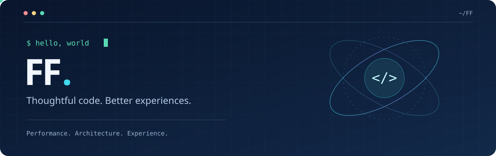

<p align="center">
  
</p>

<p align="center">
  <a href="https://github.com/liuhui9"></a>
</p>

<p align="center">
  <a href="https://github.com/liuhui9?tab=repositories"></a>
  <a href="https://github.com/liuhui9?tab=stars"></a>
  
</p>

## 👋 我是 FF

关注前端工程与产品体验，喜欢拆解复杂交互，也关注功能背后的状态流转、渲染成本和工程边界。

希望写出的代码既能承载业务，也能让下一位维护者快速理解。这里记录我的技术探索、代码实验，以及持续改进的过程。

> 把复杂留给实现，把清晰留给用户。

```ts
const developer = {
  name: 'FF',
  github: 'liuhui9',
  focus: ['Frontend engineering', 'Web performance', 'Developer experience'],
  principles: ['Explicit state', 'Clear boundaries', 'Measurable improvements'],
  mindset: 'Understand the problem before choosing the abstraction',
} as const;
```

## 🛠️ 工程关注点

<!-- 以下描述技术关注方向与工程理念，不代表已完成项目或经验证的业绩。 -->

| 方向 | 关注的问题 | 实践思路 |
| --- | --- | --- |
| 组件与架构 | 业务增长后，如何保持边界清晰 | 按职责拆分模块，区分展示与业务逻辑，通过组合复用能力 |
| 类型与数据契约 | 如何减少接口与页面之间的隐性约定 | 明确领域类型与状态分支，在输入边界校验数据 |
| 异步与状态 | 重复点击、请求乱序、卸载后返回如何处理 | 请求去重、取消与过期结果隔离，明确状态的唯一来源 |
| 渲染与性能 | 用户真正卡在哪里，优化是否有效 | 从测量入手，分析关键渲染路径、资源体积与交互延迟 |
| 工程质量 | 如何降低改动的回归风险 | 类型检查、关键路径测试、构建验证与可审查的代码差异 |
| 兼容与体验 | 不同屏幕、浏览器和输入方式是否可用 | 渐进增强、能力检测、键盘操作与清晰的状态反馈 |

## 🧠 我关心的技术细节

<details open>
<summary><strong>状态设计：让复杂交互可以推演</strong></summary>

- 区分服务端数据、页面状态与派生数据，避免重复维护同一个事实。
- 为 loading、empty、error、success 明确出口，考虑重试与恢复路径。
- 面对竞态时先定义“哪一次操作有效”，再选择取消、序列化或结果隔离。
- 在提交、弹窗队列与多步骤流程中，明确前置条件和重复触发边界。

</details>

<details>
<summary><strong>性能优化：建立证据，再决定方案</strong></summary>

- 关注首屏关键资源、长任务和交互响应，避免只凭主观感受优化。
- 根据渲染方式与数据时效性选择缓存边界、按需加载和资源优先级。
- 列表、图片与动画分别分析，谨慎使用记忆化，避免增加无效复杂度。
- 区分本地构建结果与真实浏览器、设备上的体验验证。

</details>

<details>
<summary><strong>可维护性：让每一次修改的影响范围可控</strong></summary>

- 让组件 API 表达语义，避免靠大量布尔参数拼出难以理解的状态。
- 优先复用已有能力，等重复场景稳定后再提取抽象。
- 在公共方法与组件变更时检查调用方，记录关键约束与取舍。
- 把异常处理、可观测性和恢复能力纳入功能设计。

</details>

## 🧪 技术探索清单

以下是希望持续深入的方向，相关实验会逐步沉淀到公开仓库。

- **渲染策略**：服务端渲染与客户端交互的边界，缓存失效与数据一致性。
- **交互系统**：复杂表单、弹窗调度、乐观更新，以及失败后的状态恢复。
- **设计工程**：语义化组件、设计变量、响应式布局与无障碍交互。
- **开发效率**：自动化检查、可复用工具，以及 AI 辅助开发中的结果验证。

## 🧩 技术工具箱

<!-- 预设技术徽章不代表已核实的个人技能，发布前请按实际情况调整。 -->
<p>
  
  
  
  
  
  
  
</p>

## 📡 开源信号

<p align="center">
  <a href="https://github.com/liuhui9?tab=repositories"></a>
</p>
<p align="center">
  <a href="https://github.com/liuhui9?tab=repositories"></a>
</p>

<p align="center"><sub>基于公开数据生成；语言占比反映仓库代码分布。</sub></p>

## 🐍 每一次贡献，都留下轨迹

<picture>
  <source media="(prefers-color-scheme: dark)" srcset="https://raw.githubusercontent.com/liuhui9/liuhui9/output/github-snake-dark.svg" />
  <source media="(prefers-color-scheme: light)" srcset="https://raw.githubusercontent.com/liuhui9/liuhui9/output/github-snake.svg" />
  
</picture>

<!-- 首次运行工作流后，output 分支会包含上述两张动画。 -->

## 🔭 继续探索

**[查看我的项目](https://github.com/liuhui9?tab=repositories)** · **[看看我收藏的工具](https://github.com/liuhui9?tab=stars)**

---

<p align="center"><sub>感谢来访 · Keep building, keep sharing.</sub></p>
